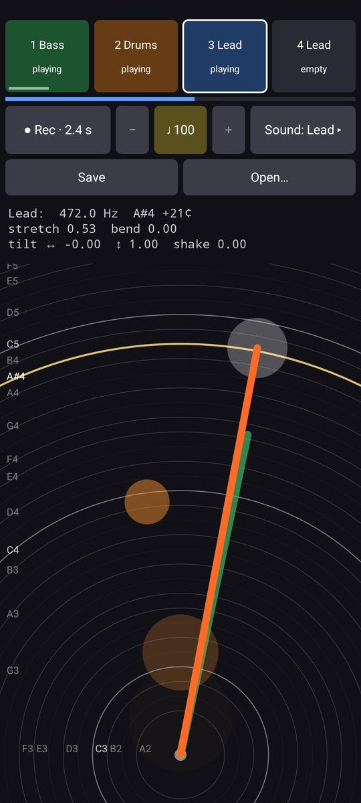
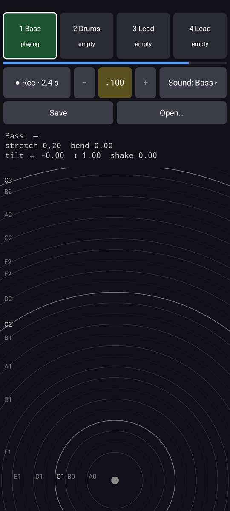
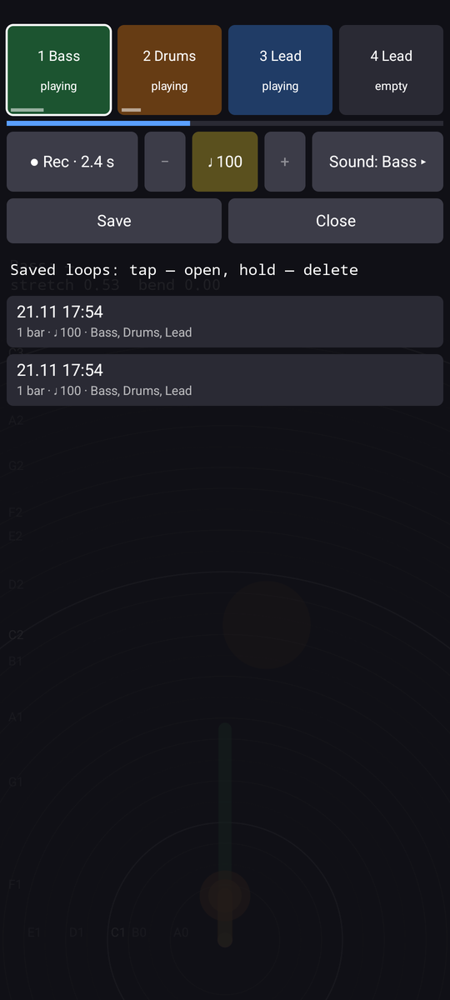

# Rezina Loop Machine

*Rezina* is Russian for "rubber". This Android app turns your phone into a rubber band you play with your fingers.

- **Stretch** the band to change the pitch.
- **Bend** it to add drive and resonance.
- **Tilt** the phone to make the sound brighter or add vibrato.
- **Shake** it to make the sound wobble.

The app is also a 4-track looper. Record a bass line, add drums over it, then a melody. All of it is played on the same band, switched between three modes.

<p>
  
  
  
</p>

## Download

**[⬇ rezina-loop-machine.apk](https://github.com/serg123e/rezina-loop-machine/releases/latest/download/rezina-loop-machine.apk)**: Android 8.0 or newer.

It is a prototype and is not in the Play Store. To install it, open the file on your phone and allow installs from your browser or file manager when Android asks.

### Can I trust this APK?

The APK is never built on anyone's laptop. [GitHub Actions](.github/workflows/release.yml) builds it from the code in this repository and publishes it to [Releases](https://github.com/serg123e/rezina-loop-machine/releases). Each release has a signed [build provenance attestation](https://docs.github.com/en/actions/security-guides/using-artifact-attestations-to-establish-provenance-for-builds), which ties the file to the exact commit and workflow run that produced it.

How to check the APK:

```bash
gh attestation verify rezina-loop-machine.apk -R serg123e/rezina-loop-machine
```

The attestation can also be read on the release's [attestations page](https://github.com/serg123e/rezina-loop-machine/attestations).

All releases are signed with the same key. Its SHA-256 certificate fingerprint is:

```
b1:b0:51:c1:65:e1:cf:3f:0b:48:a1:dd:09:5a:15:e5:0a:22:2a:ba:70:eb:38:09:1b:9d:26:f6:04:f5:32:56
```

The app asks for **no permissions**: no internet, no microphone, no storage. You can see this in the [manifest](app/src/main/AndroidManifest.xml).

You can also skip the download and build it yourself (see [Build](#build)).

## How to play

| You do | Sound |
|---|---|
| Stretch the band: one finger pulls it from the peg at the bottom; two or more fingers set both ends | Pitch and volume |
| Bend the band: move a middle finger off the straight line | Drive and filter resonance |
| Tilt the phone left or right | Brightness (filter cutoff) |
| Raise the phone from flat to upright | Vibrato depth |
| Shake the phone | Wobble; in Drums mode, a shaker |
| New finger in **Drums** mode | A hit: kick near the peg, then snare/tom, then hi-hat far away |

With one finger, the rings around the peg are a note grid. Each ring is a semitone, and the C rings are labelled.

## Looper

- **Tracks.** Tap a track to select it. Tap the selected track to mute it. Hold a track to erase it.
- **First take.** **● Rec** plays a one-bar count-in, then records. Press **■ Stop** to end the take. The take is rounded to whole bars and sets the loop length.
- **Later takes.** Each one records exactly one loop and stops by itself.
- **Metronome and tempo.** **♩** turns the metronome on or off, before or during the loop. **−** and **+** set the tempo before the first take.
- **Sound.** **Sound** switches the selected track between Bass, Drums and Lead. It works on a track that is already recorded too.
- **Saving.** **Save** and **Open…** keep loops on the phone. In the list, tap a loop to load it, or hold it to delete it.

Tracks store your **gestures**, not audio. Each track is replayed through its own synth voice and drawn as a "ghost band" in the track's colour, so you see how each part was played.

## Build

You need JDK 21 and the Android SDK with platform 37.

```bash
./gradlew assembleDebug
adb install -r app/build/outputs/apk/debug/app-debug.apk
```

There are no third-party libraries. The synth is plain `AudioTrack` and the UI is one custom `View`. See [CLAUDE.md](CLAUDE.md) for how the code is organised.

## License

[MIT](LICENSE)
